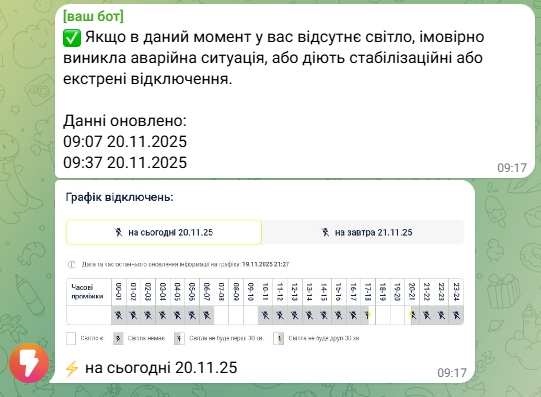

# detek-to-telegram

[](https://opensource.org/licenses/MIT)
[](https://github.com/riv-gh/detek-to-telegram)

## 🌐 Languages
- [English](README.md)
- [Русский](README.ru.md)
- [Українська](README.uk.md)

A small service that forwards notifications (charts and messages) about power outages to Telegram.

[](#)

## Features
- Forwards text notifications to a specified Telegram chat.
- Simple configuration via environment variables.

## Quick start

1. Create a Telegram bot via BotFather and get the token.
2. Find out the chat_id (send a message to the bot and check the log).
3. Download the repository [Download ZIP](https://github.com/riv-gh/detek-to-telegram/archive/refs/heads/master.zip) or clone it `git clone https://github.com/riv-gh/detek-to-telegram.git`
4. Move to the project directory `cd detek-to-telegram` and install dependencies `npm install`
5. Set environment variables and start the application `npm start`. 

## Environment variables (.env)
- TELEGRAM_BOT_TOKEN — bot token
- CHAT_ID — chat id
- CHAT_ID_GROUP — group or channel id
- CITY — city (can be omitted for Kyiv)
- STREET — street name
- HOUSE — house number
- SEND_EMPTY_SHUTDOWN_DAY - (true|false) send empty shutdown day graphic image
- USE_CUSTOM_STYLING - (true|false) whether to use additional styles from the file customPageStyle.css
- BROWSER_EXECUTABLE_PATH - specify the path to the browser (if need), for example: /usr/bin/chromium-browser (Linux only)
- DTEK_LINK - a link to the DTEK website for your region (unless it is KEM or KREM), for example: https://www.dtek-dnem.com.ua/ua/shutdowns

Example .env file (the file must be named `.env`):
```
TELEGRAM_BOT_TOKEN=123456:ABC-DEF..
CHAT_ID=-1001234567890
CITY=м. Київ
STREET=вул. Арсенальна
HOUSE=15
SEND_EMPTY_SHUTDOWN_DAY=false
USE_CUSTOM_STYLING=false
```


Example (Linux/macOS):
```bash
export TELEGRAM_BOT_TOKEN=123456:ABC-DEF...
export CHAT_ID=-1001234567890
...
npm start
```

Example Windows (PowerShell):
```powershell
$env:TELEGRAM_BOT_TOKEN = "123456:ABC-DEF..."
$env:CHAT_ID = "-1001234567890"
...
npm start
```

To install puppeteer on Linux without a graphical environment (or in a Docker container), additional libraries are required.
```bash
sudo apt-get update
sudo apt-get install -y \
  libglib2.0-0 libx11-6 libx11-xcb1 libxcb1 libxcomposite1 libxcursor1 \
  libxdamage1 libxext6 libxfixes3 libxi6 libxrandr2 libxrender1 libxss1 \
  libxtst6 libgtk-3-0 libatk1.0-0 libatk-bridge2.0-0 libpangocairo-1.0-0 \
  libpango-1.0-0 libcairo2 libcups2 libdbus-1-3 libexpat1 libfontconfig1 \
  libgbm1 libasound2 libnspr4 libnss3 libstdc++6 libgcc1
```