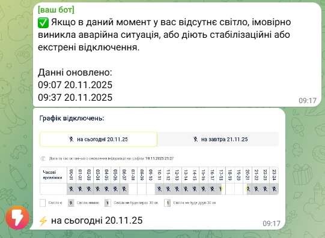

# detek-to-telegram

[](https://opensource.org/licenses/MIT)
[](https://github.com/riv-gh/detek-to-telegram)

## 🌐 Языки
- [English](README.md)
- [Русский](README.ru.md)
- [Українська](README.uk.md)

Небольшой сервис, пересылающий уведомления (графики и сообщения) о отключении электроэнерии в Telegram.

[](#)

## Особенности
- Пересылка текстовых уведомлений в указанный Telegram-чат.
- Простая конфигурация через переменные окружения.

## Быстрый старт

1. Создайте Telegram-бота через BotFather и получите токен.
2. Узнайте chat_id (отправив сообщение боту и проверив лог).
3. Скачайте репозиторий [Скачать ZIP](https://github.com/riv-gh/detek-to-telegram/archive/refs/heads/master.zip) или клониуйте его `git clone https://github.com/riv-gh/detek-to-telegram.git`
4. Перейдите в папку `cd detek-to-telegram` и установите зависимости `npm install`
5. Установите переменные окружения (.env) и запустите приложение при помощи `npm start`

## Переменные окружения .env
- TELEGRAM_BOT_TOKEN - токен бота
- CHAT_ID -  токен бота
- CHAT_ID_GROUP - id чата или канала
- CITY - город (в случае Киева можно не указывать)
- STREET - название улицы
- HOUSE - номер дома
- SEND_EMPTY_SHUTDOWN_DAY - (true|false) отправлять изображение графика без отключений
- USE_CUSTOM_STYLING - (true|false) использовать ли дополнителные стили из файла customPageStyle.css
- BROWSER_EXECUTABLE_PATH - указать свой путь к браузеру при необходимости, например: /usr/bin/chromium-browser (только linux) 
- DTEK_LINK — ссылка на сайт DTEK для вашего региона (если это не KEM или KREM), например: https://www.dtek-dnem.com.ua/ua/shutdowns

Пример .env файла (файл має мати назву `.env`):
```
TELEGRAM_BOT_TOKEN=123456:ABC-DEF..
CHAT_ID=-1001234567890
CITY=м. Київ
STREET=вул. Арсенальна
HOUSE=15
SEND_EMPTY_SHUTDOWN_DAY=false
USE_CUSTOM_STYLING=false
```

Пример (Linux/macOS):
```bash
export TELEGRAM_TOKEN=123456:ABC-DEF...
export TELEGRAM_CHAT_ID=-1001234567890
...
npm start
```

Пример Windows (PowerShell):
```powershell
$env:TELEGRAM_TOKEN = "123456:ABC-DEF..."
$env:TELEGRAM_CHAT_ID = "-1001234567890"
...
npm start
```

Для установки puppeteer на Linux без графичиского окружения (или в Docker-конетйнер) необходимы дополнительные библиотеки
```bash
sudo apt-get update
sudo apt-get install -y \
  libglib2.0-0 libx11-6 libx11-xcb1 libxcb1 libxcomposite1 libxcursor1 \
  libxdamage1 libxext6 libxfixes3 libxi6 libxrandr2 libxrender1 libxss1 \
  libxtst6 libgtk-3-0 libatk1.0-0 libatk-bridge2.0-0 libpangocairo-1.0-0 \
  libpango-1.0-0 libcairo2 libcups2 libdbus-1-3 libexpat1 libfontconfig1 \
  libgbm1 libasound2 libnspr4 libnss3 libstdc++6 libgcc1
```