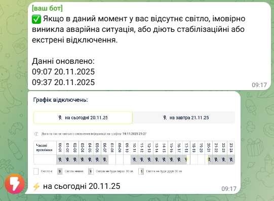

# detek-to-telegram

[](https://opensource.org/licenses/MIT)
[](https://github.com/riv-gh/detek-to-telegram)

## 🌐 Мови
- [English](README.md)
- [Русский](README.ru.md)
- [Українська](README.uk.md)

Невеликий сервіс, який пересилає повідомлення (графіки та тексти) про відключення електроенергії в Telegram.

[](#)

## Особливості
- Пересилка текстових повідомлень у вказаний Telegram-чат.
- Проста конфігурація через змінні оточення.

## Швидкий старт

1. Створіть Telegram-бота через BotFather і отримайте токен.
2. Дізнайтеся chat_id (надішліть повідомлення боту і перевірте лог).
3. Завантажте репозиторій [Завантажити ZIP](https://github.com/riv-gh/detek-to-telegram/archive/refs/heads/master.zip) або колонуйте його `git clone https://github.com/riv-gh/detek-to-telegram.git`
4. Перейдіть у папку проекту `cd detek-to-telegram` та встановіть залежності `npm install`
5. Встановіть змінні оточення та запустіть застосунок.

## Змінні оточення (.env)
- TELEGRAM_BOT_TOKEN — токен бота
- CHAT_ID — id чату
- CHAT_ID_GROUP — id групи або каналу
- CITY — місто (для Києва можна не вказувати)
- STREET — назва вулиці
- HOUSE — номер будинку
- SEND_EMPTY_SHUTDOWN_DAY - (true|false) надсилати зображення графіка без відключень
- USE_CUSTOM_STYLING - (true|false) використовувати додаткові стилі з файлу customPageStyle.css
- BROWSER_EXECUTABLE_PATH - вказати шлях до браузера за потреби, наприклад: /usr/bin/chromium-browser (лише linux)

Приклад .env файлу (файл має мати назву `.env`):
```
TELEGRAM_BOT_TOKEN=123456:ABC-DEF..
CHAT_ID=-1001234567890
CITY=м. Київ
STREET=вул. Арсенальна
HOUSE=15
SEND_EMPTY_SHUTDOWN_DAY=false
USE_CUSTOM_STYLING=false
```

Приклад (Linux/macOS):
```bash
export TELEGRAM_BOT_TOKEN=123456:ABC-DEF...
export CHAT_ID=-1001234567890
...
npm start
```

Приклад Windows (PowerShell):
```powershell
$env:TELEGRAM_BOT_TOKEN = "123456:ABC-DEF..."
$env:CHAT_ID = "-1001234567890"
...
npm start
```

Для встановлення puppeteer на Linux без графічного оточення (або Docker-конетйнер) необхідні додаткові бібліотеки
```bash
sudo apt-get update
sudo apt-get install -y \
  libglib2.0-0 libx11-6 libx11-xcb1 libxcb1 libxcomposite1 libxcursor1 \
  libxdamage1 libxext6 libxfixes3 libxi6 libxrandr2 libxrender1 libxss1 \
  libxtst6 libgtk-3-0 libatk1.0-0 libatk-bridge2.0-0 libpangocairo-1.0-0 \
  libpango-1.0-0 libcairo2 libcups2 libdbus-1-3 libexpat1 libfontconfig1 \
  libgbm1 libasound2 libnspr4 libnss3 libstdc++6 libgcc1
```